# BiblioTech Scout — Biblioteca Digital y Buscador Documental Scout

**Proyecto sin fines de lucro · Creador:** Liam Durán · Comunidad de Caminantes · Provincia Tláhuac-Xochimilco  
**Contacto:** `rdc.tlxh@gmail.com`  
**Fuentes documentales:** Documentos oficiales de la Asociación de Scouts de México, A.C. (ASMAC) y World Scouting (WOSM)  
**Base de datos:** 12/11/2026 • **Versión:** BETA `8.4.1` (Web) • `2.3.1` Mobile  
**Sitio web público:** https://ey-liam.github.io/bibliotech-scouts/  
**App Android oficial (APK):** https://github.com/ey-liam/bibliotech-scouts-app/releases

---

## 1. Qué es BiblioTech Scout y cómo funciona

**BiblioTech Scout** es una plataforma educativa, gratuita y de código abierto diseñada para consultar en segundos manuales, fichas FES, plantillas RECME, reglamentos, libros históricos, avisos vigentes y preguntas frecuentes oficiales del escultismo nacional e internacional, siempre mostrando la fuente exacta de donde proviene cada dato.

- **No requiere descarga obligatoria:** Todas las herramientas de búsqueda (`13,516` preguntas y respuestas verificadas), el catálogo completo (`599` documentos), el modo oscuro, los visores integrados y los recursos rápidos funcionan directamente desde cualquier navegador de escritorio, tablet o celular.
- **Uso sin conexión (Offline):**
  - En **iPhone / iPad (iOS Safari):** se instala gratis como Web App desde *Compartir → Agregar a inicio* con ícono compatible con iOS / Liquid Glass (`img/apple-touch-icon.png`) y caché PWA (`sw.js`).
  - En **Android (APK oficial):** la app nativa empaca las preguntas e interfaz para abrirlas sin internet y añade gestor de descargas offline de hasta los `599` documentos.

---

## 2. Convención de Versionado de 3 Dígitos (`MAJOR.MINOR.PATCH`)

A partir de la versión **8.4.1** (Web) y **2.3.1** (Android), todo el ecosistema utiliza numeración semántica de tres dígitos:

- **Primer dígito (`X.0.0`):** Cambio mayor, rediseño estructural completo o salto de arquitectura.
- **Segundo dígito (`X.Y.0`):** Incorporación de nuevas funcionalidades relevantes, apartados o ampliaciones documentales significativas.
- **Tercer dígito (`X.Y.Z`):** Ajustes visuales, correcciones de errores, optimizaciones de rendimiento, accesibilidad o mejoras menores sin alterar el esquema principal.

---

## 3. Comparación: Modo Claro vs Modo Oscuro

El sitio detecta preferencias del usuario y ofrece cambio instantáneo entre **Modo Claro** (colores claros luminosos con texto oscuro de alto contraste para lectura diurna) y **Modo Oscuro** (fondos cósmicos oscuros unificados con animación ambiental coherente, tarjetas contrastadas y descanso visual nocturno).

### Escritorio (`1366×860`)

| Modo Claro (Predeterminado) | Modo Oscuro (Modo Noche) |
| :---: | :---: |
| 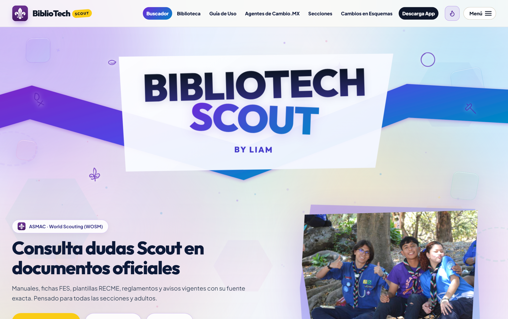 | 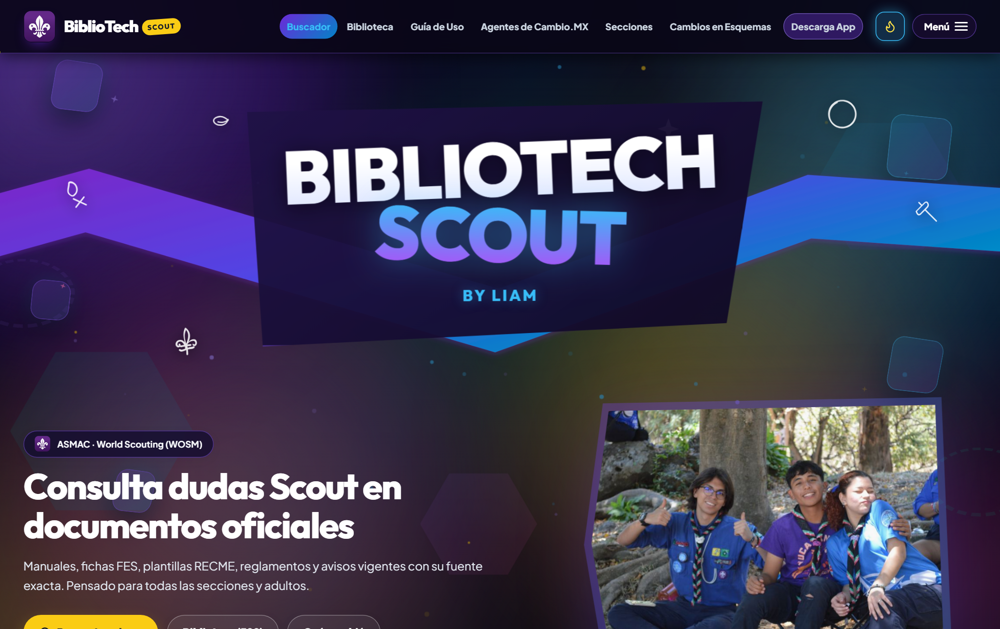 |

### Teléfono Móvil (`390×844`)

| Móvil Web — Modo Claro | Móvil Web — Modo Oscuro |
| :---: | :---: |
| 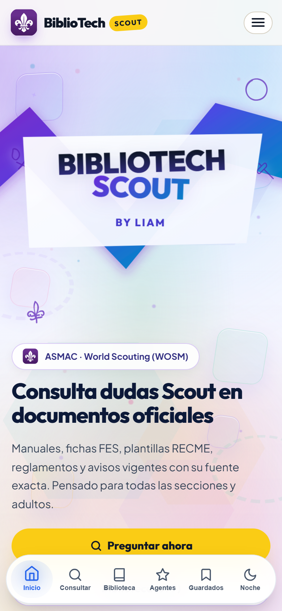 | 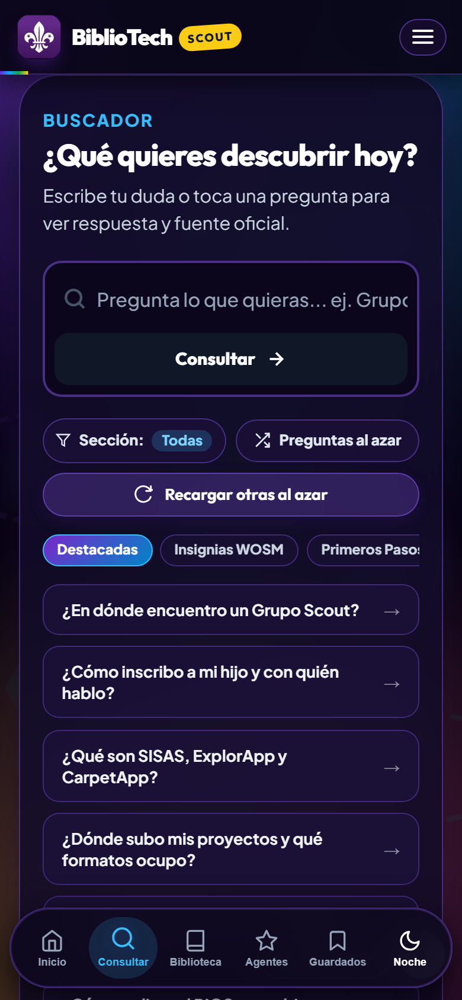 |

---

## 4. Vistas por Dispositivo y Plataforma

### Tablet (Navegador y App Android APK) vs iPhone / iPad (iOS Safari Web App)

| Tablet Web (`820×1080`) | iPhone / iPad (`iOS Safari` Web App) |
| :---: | :---: |
| 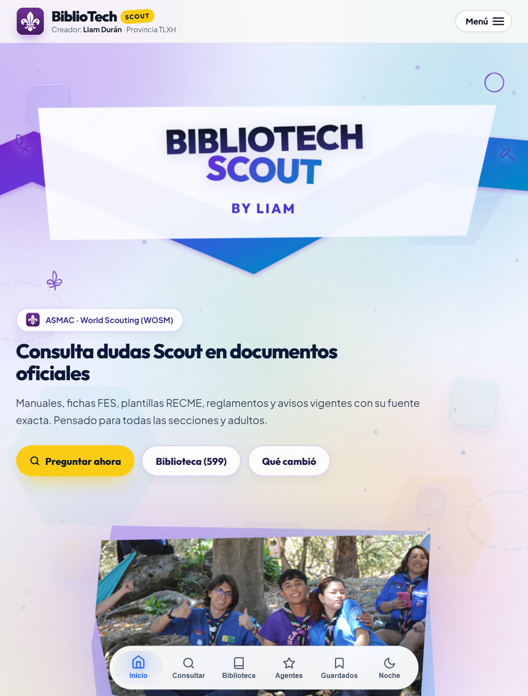 | 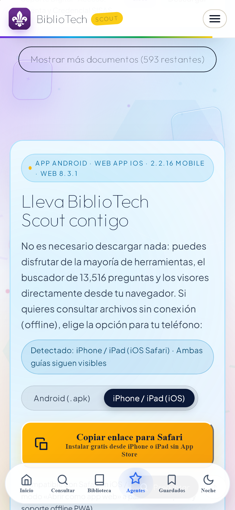 |

### Teléfono y Tablet con App Android (APK `v2.3.1`)

| Teléfono Android (`APK`) | Tablet Android (`APK`) |
| :---: | :---: |
|  | 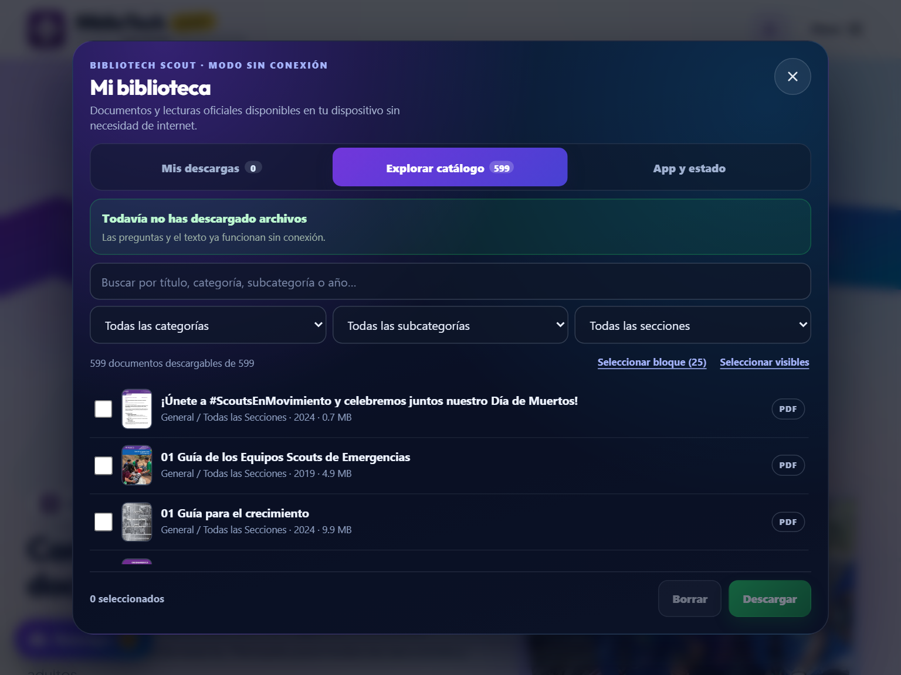 |

---

## 5. Apartados del Sitio y Qué Puedes Hacer en Cada Uno

| Apartado | Función y qué puedes hacer ahí | Vista |
| :--- | :--- | :---: |
| **Buscador (`#buscador`)** | Escribe cualquier duda scout, filtra por sección (*Manada*, *Tropa*, *Comunidad*, *Clan*, etc.), abre el filtro rápido de **Sección**, genera **Preguntas al azar** o pulsa **Recargar otras al azar**, lee respuestas fundamentadas con fuente documental exacta y escúchalas con lectura en voz alta. | 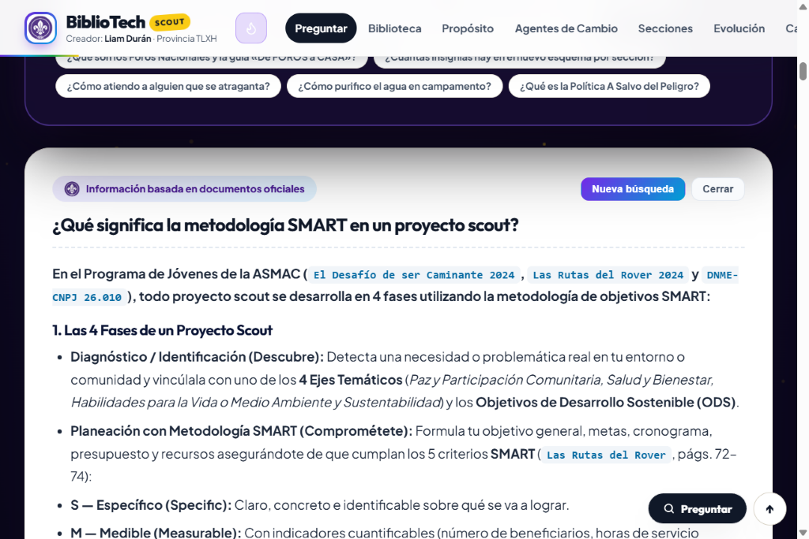 |
| **Biblioteca Scout (`#biblioteca`)** | Filtra por texto, sección, colección (*Centenario*, *Guías y PJOS*, *FES*, *RECME y FAES*, *SISAS y Help Desk*, *Manuales*, *Reglamentos*, *Comunicados*, etc.) o subcategoría entre los `599` documentos; guarda favoritos, toma notas locales y abre PDFs, hojas Excel con filtro/CSV, presentaciones, guías HTML o imágenes sin salir del sitio. | 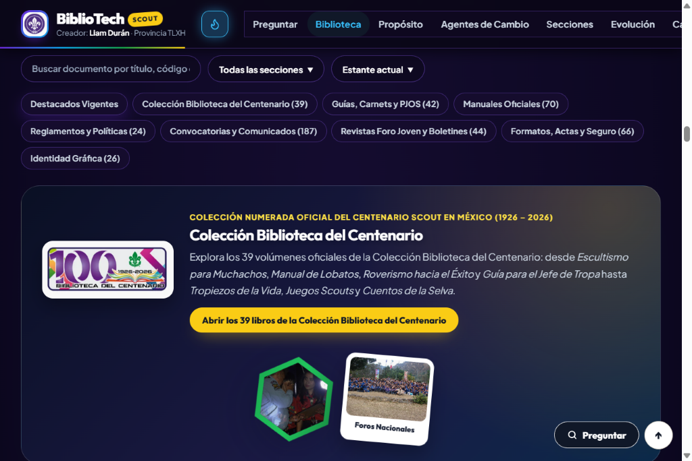 |
| **Guía de Uso (`#guia`)** | Tarjetas plegables numeradas (*01 Primeros Pasos*, *02 Ecosistema Digital*, *03 Campo Escuela Meztitla*, etc.) con respuestas rápidas, cuotas de registro, permisos JL304 y enlaces oficiales al tocar cada tema. | 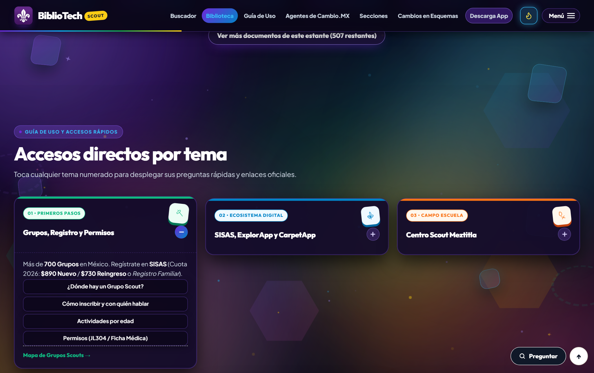 |
| **Secciones Scouts (`#secciones`)** | Acceso directo unificado por rango de edad (*Manada de Lobatos*, *Tropa de Scouts*, *Comunidad de Caminantes*, *Clan de Rovers*, *Adultos y Dirigentes* y *World Scouting WOSM*) para filtrar al instante sus documentos, progresiones e insignias. | 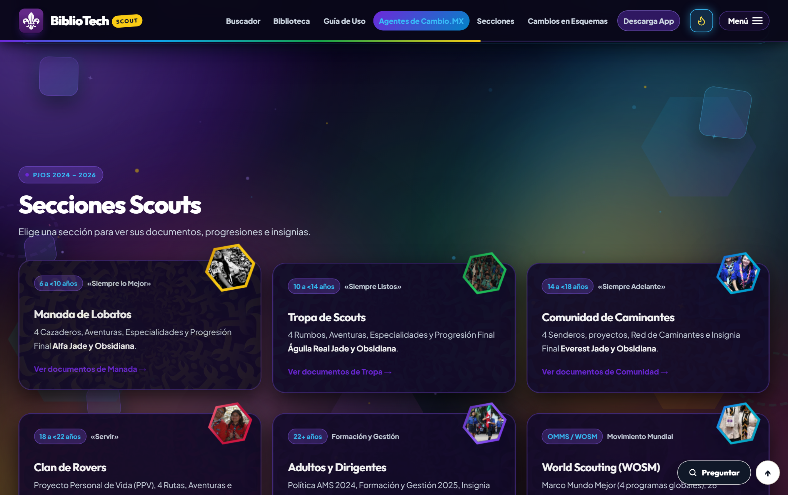 |
| **El Proyecto (`#acerca`)** | Presentación transparente del proyecto sin fines de lucro, su objetivo educativo, resumen de capacidades, datos de autoría y correo de contacto para reportar preguntas o mejoras. | 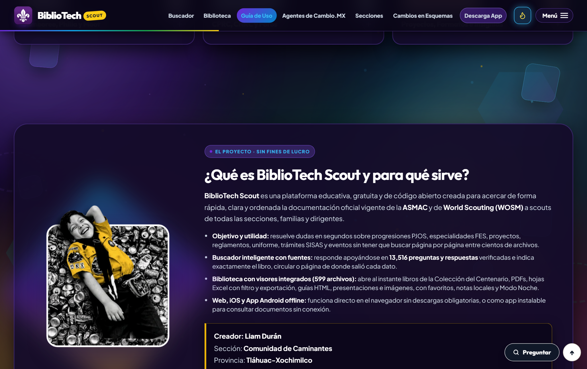 |

*(Además, desde la barra superior o el botón **Menú** accedes de forma ordenada a **Agentes de Cambio.MX**, **Servicios y Trámites**, **Cambios en Esquemas** y **Descarga App**).*

---

## 6. Comparativa de Funciones: Web / iOS Web App vs App Android (APK)

| Capacidad | Sitio Web (Escritorio / Móvil) | iOS Safari Web App (iPhone / iPad) | App Android (APK Oficial) |
| :--- | :---: | :---: | :---: |
| Buscador con `13,516` preguntas y fuentes exactas | En línea / Offline opcional | Descarga offline iOS Safari/PWA (`11 MB` o completo) | 100% Offline nativo |
| Biblioteca de `599` documentos con visores integrados | En línea | En línea | En línea + Descarga offline |
| Favoritos (`Guardados`), historial reciente y notas locales | Cookies + `localStorage` | Cookies + `localStorage` | Guardados + Almacenamiento nativo |
| Modo Claro y Modo Oscuro unificados | Incluido | Incluido | Incluido |
| Lector PDF nativo (`PdfRenderer`) con zoom y modo noche | Visor web embebido | Visor Safari iOS | Nativo de Android por página |
| Gestor de descargas por lote (25 o individuales) | Descarga individual | Descarga Safari | Nativo (`Mi biblioteca`) |
| Actualizaciones en segundo plano (interfaz y `data/`) | Automática al recargar | Automática (`sw.js`) | Descarga atómica OTA integrada |

---

## 7. Herramientas y Tecnologías Utilizadas

El proyecto está construido evitando dependencias pesadas en el cliente y apoyado en herramientas verificables en el repositorio:

- **Frontend e Interfaz Web:** `HTML5` semántico, `CSS3` (variables personalizadas, animaciones GPU, diseño responsivo desktop/tablet/móvil y modos Claro/Oscuro), `JavaScript (ES6+)`.
- **Web App y Accesibilidad:** PWA (`manifest.webmanifest`, `sw.js` con estrategia *Network-First*), ícono compatible con iOS (`img/apple-touch-icon.png`) y `Web Speech API` para lectura en voz alta.
- **Procesamiento, Build y Calidad (`scripts/` y CI):** `Node.js` (`esbuild` para minificación CSS/JS desde `src/` y validaciones en GitHub Actions `ci.yml`); `Python 3` con `pypdfium2` (extracción de texto PDF), `Pillow` (generación y optimización de portadas JPG e íconos), `openpyxl` (procesamiento de hojas Excel) y `Playwright` (pruebas E2E en escritorio, móvil e iOS).
- **Infraestructura y Distribución:** `GitHub Pages` para publicación automática del sitio web, `GitHub Actions` para CI automatizado y `Cloudflare Workers Free` (plantilla preparada en `scripts/cloudflare-worker-telemetry.js`).

---

## 8. Novedades Recientes (`8.4.1`)

- **Telemetría conectada a Cloudflare Workers Free (`bibliotech-telemetry`) con respaldo automático:** envía actividad y errores JS al Worker con registro en *Observability Logs* y respaldo automático a `FormSubmit` si se alcanza el límite gratuito diario.
- **Modo Offline real en iOS Safari / Web App (`sw.js v34`):** nuevo módulo interactivo en `#app` para descargar al caché local del iPhone/iPad o navegador las `13,516` preguntas, el catálogo y tablas Excel (~`11 MB`, con opción de incluir `chunks.json`), barra de progreso en tiempo real y aviso automático cuando trabajas sin señal.
- **Depuración y minificación CSS/JS (`src/` -> raíz con `esbuild`):** reducción de `styles.css` (`~312 KB -> ~220 KB`) y `app.js` (`~206 KB -> ~128 KB`), separando la documentación técnica interna a `ARCHITECTURE.md` y limpiando `12` PNGs duplicados en `img/deco/` y `assets/scouts/agentes_cambio/`.
- **Calidad automatizada en GitHub (`ci.yml`) y atajos de teclado:** validación automática en cada push/PR de sintaxis, JSONs, rutas, desbordes y flujo offline en Playwright, más atajo `/` o `Ctrl+K` para abrir el buscador al instante.
- **Verificación `SHA-256` en Android y telemetría escalable:** enlace directo a `bibliotech-scout.apk.sha256` en la pestaña Android y soporte listo para conectar un Cloudflare Worker gratuito en `BT_TELEMETRY_CONFIG`.

---

## 9. Estructura Principal del Repositorio

```text
bibliotech-scouts/
├── index.html                  # Estructura semántica principal (12 apartados ordenados)
├── src/                        # Fuente editable: styles.css y app.js
├── styles.css / app.js         # Salida depurada y minificada generada con npm run build
├── sw.js                       # Service Worker PWA (bibliotech-scout-v34)
├── manifest.webmanifest        # Manifiesto Web App / PWA (iconos maskable y shortcuts)
├── data/                       # catalog.json, questions_bank.json, faq_v3.json, faq_v4.json, kb, chunks
├── covers/                     # Carátulas optimizadas en JPG (599 documentos)
├── img/                        # Logotipos, fondos temáticos, galería y apple-touch-icon.png
├── assets/                     # Recursos gráficos y multimedia locales
├── scripts/                    # build-assets.mjs, validate-site.mjs, smoke_e2e.py, Cloudflare Worker y Python
├── .github/workflows/ci.yml    # CI automatizado (validación + E2E Playwright)
├── ARCHITECTURE.md             # Documentación técnica y traspaso interno
└── docs/screenshots/           # Capturas verificadas de escritorio, tablet, móvil, iOS y Android
```
