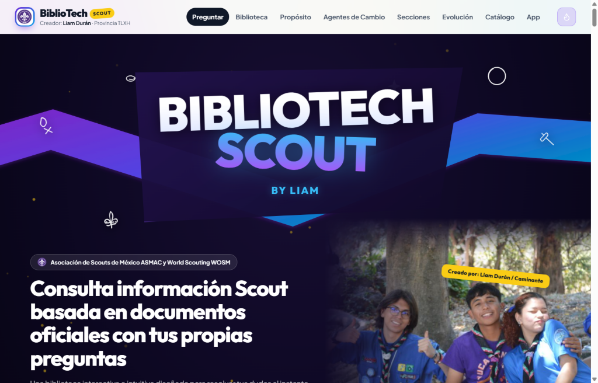
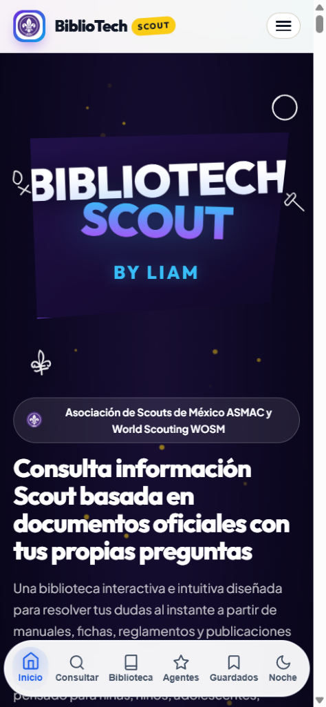
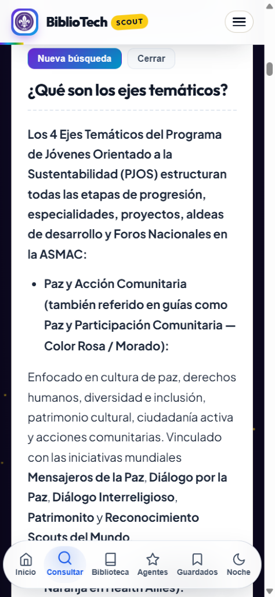

# BiblioTech Scout — Biblioteca Digital y Buscador Documental Scout

**Creador:** Liam Durán - Provincia TLXH (Instagram: [@liaadurg3](https://www.instagram.com/liaadurg3/))  
**Fuentes documentales:** Asociación de Scouts de México, A.C. (ASMAC) y World Scouting (WOSM)  
**Base de datos:** 11/11/2026 • **Versión:** V7 Oficial - 2.2.2 Mobile (11/11/2026)  
**Sitio web público:** https://ey-liam.github.io/bibliotech-scouts/

---

## 1. Propósito del proyecto

**BiblioTech Scout** es una plataforma web pública, personal y sin fines de lucro diseñada para que niñas, niños, adolescentes, jóvenes y adultos de toda la membresía cuenten con acceso directo, ágil y de fácil comprensión a la documentación oficial de la **Asociación de Scouts de México, A.C. (ASMAC)** y de **World Scouting (WOSM)**.

Todas las respuestas y resúmenes se fundamentan exclusivamente en los documentos oficiales, manuales, reglamentos, libros de la Colección Biblioteca del Centenario, revistas, formatos editables, comunicados nacionales y portales institucionales respaldados en la base de datos local (con corte al **11/11/2026**), priorizando siempre las ediciones vigentes (2024–2026).

---

## 2. Capturas de pantalla y cómo se usa (Escritorio y Móvil)

### Sitio Web (Escritorio)

| Portada Cósmica y Accesos Rápidos | Consultas Directas (ej. Metodología SMART) | Biblioteca Scout en Modo Noche |
| :---: | :---: | :---: |
|  |  |  |

**Cómo usarlo en computadora:**
1. Entra a `https://ey-liam.github.io/bibliotech-scouts/`.
2. Haz clic en **Hacer una pregunta** (o ve directo a **Buscador:**) y escribe tu duda en lenguaje sencillo (por ejemplo: *"¿Qué es un proyecto SMART?"*, *"¿Qué dice el Reglamento sobre el Artículo 10?"*, *"¿Cómo funciona ExplorApp?"*). También puedes pulsar el botón de recarga para explorar preguntas aleatorias del banco o filtrar por sección (*Manada, Tropa, Comunidad, Clan, Adultos, World Scouting*).
3. Al abrir una respuesta verás el texto fundamentado y, debajo, las fuentes oficiales exactas en **Documentos oficiales de donde se obtuvo esta información** para abrir el visor o descargar el archivo.
4. Usa la barra superior para cambiar entre **Preguntar**, **Biblioteca** (con lector de PDF/imágenes integrado y los 39 libros del Centenario), **Propósito**, **Agentes de Cambio**, **Secciones**, **Evolución**, **Catálogo** y **App**, o pulsa el icono de llama/luna para alternar el **Modo Noche**.

### Versión Móvil (Navegador en Teléfono)

| Inicio con Dock Inferior Unificado | Lectura Clara de Respuestas en Móvil |
| :---: | :---: |
|  |  |

**Cómo usarlo en teléfono:**
1. En pantallas pequeñas el sitio muestra el dock inferior flotante con acceso de un toque a **Inicio**, **Consultar**, **Biblioteca**, **Agentes**, **Guardados** y **Noche**, además del botón **Menú** arriba para navegar por el resto de apartados y el Catálogo.
2. Todas las tarjetas de respuesta, fuentes, estantes y lector de PDF se ajustan automáticamente al ancho de tu pantalla.

---

## 3. Novedades de la Versión V7 y Banco Ampliado V4 (11/11/2026)

- **Duplicación del Banco de Preguntas (`faq_v4.json` — 11,254 preguntas totales):**
  - El repositorio pasa de 5,457 a **11,254 preguntas y respuestas únicas** (`5,356` en `data/questions_bank.json`, `101` en `data/faq_v3.json` y **`5,797`** nuevas en `data/faq_v4.json`, generadas con `scripts/generate_faq_v4.js`).
  - Incluye explicaciones claras y directas sobre objetivos **SMART**, ciclo **PER** (*Planeo, Ejecuto, Reviso*), los **4 Ejes Temáticos**, sistemas nacionales (`SISAS`, `ExplorApp`, `CarpetApp`, `CDC`), artículos reales de normativas vigentes (`Reglamento 2023`, `Estatutos 2023`, `Manual del Uniforme junio 2026`, `Reglamento CNH 2025`), términos de **glosarios oficiales**, capítulos de manuales/políticas, los **39 libros de la Biblioteca del Centenario**, páginas HTML e infografías.
  - La ampliación V4 añade tres capas documentales: campos etiquetados de **convocatorias** (dirigido a, sede, fechas, cuotas, requisitos, contacto y modalidad), campos y actos de **formatos, actas y seguro** (asunto, datos solicitados, autorizaciones, documentos anexos y orden del día), y **menciones textuales con página y cita** en manuales, libros del Centenario e identidad gráfica.
- **Nueva Portada Hero Cósmica Dinámica:**
  - Lienzo poligonal estilizado con cinta diagonal en zigzag en gradiente morado a azul eléctrico y cian neón (`#7928ca` a `#06b6d4`) con resplandor suave.
  - Tarjeta central inclinada destacando el título en gran formato `BIBLIOTECH SCOUT` y la firma de autoría centralizada `By Liam`.
  - 10 doodles vectoriales en blanco puro (fogata, flor de lis, mundo, señalización, sol, hoja, destellos, brújula, nudo y carpa) flotando suavemente alrededor del escenario.
- **Fondo Cósmico Continuo en el Buscador:**
  - El fondo azul/morado profundo se extiende fluidamente hasta la sección del buscador (`#seccion-buscador`), integrando cubos geométricos flotantes 3D decorativos en tonalidades cósmicas.
  - Tarjeta de búsqueda con cristal translúcido oscuro de alto contraste y legibilidad impecable.
- **Renovación del Buscador:**
  - Encabezado simplificado a `Buscador:`.
  - Botón de recarga de preguntas con icono circular de actualización y leyenda `Mostrar más preguntas` para explorar preguntas aleatorias del banco documental.
- **Estabilidad de Marca en Móviles:**
  - Garantizada la visualización completa de `BiblioTech Scout` en teléfonos y pantallas pequeñas sin truncar el distintivo "Scout".
- **Modo Noche / Visión Nocturna Limpio:**
  - Reemplazo total del filtro ámbar/sepia por un modo oscuro limpio de alto contraste: fondos negros/índigo cósmicos profundos, texto blanco nítido y acentos cian, manteniendo imágenes, botones, badges y documentos legibles.
  - Botón de modo noche visible en la cabecera de escritorio y oculto en móvil para evitar duplicación con el dock inferior.

---

## 4. Identidad e interfaz

- **Nombre del sitio:** BiblioTech Scout: By Liam.
- **Menú superior:** sigue el orden real de las secciones de la página: *Preguntar → Biblioteca → Propósito → Agentes de Cambio → Secciones → Evolución → Catálogo*.
- **Fondo animado:** una capa viva con malla de auras de color, orbes flotantes, haz de luz diagonal, hexágonos, cubos, anillos y destellos. Solo anima `transform` y `opacity` para no alterar el diseño ni el rendimiento.
- **Secciones translúcidas:** dejan ver la aurora de fondo sin sacrificar la legibilidad; las tarjetas de contenido permanecen blancas.
- **Accesibilidad:** con `prefers-reduced-motion` activo, todas las animaciones se detienen. El sitio conserva navegación por teclado, enlace para saltar al contenido y etiquetas ARIA.

---

## 5. Contenido del acervo documental

El sistema integra **110 temas enciclopédicos y literarios**, **11,254 preguntas y respuestas únicas de consulta directa** (`5,356` del banco base, `101` de `faq_v3.json` y `5,797` de `faq_v4.json`, abarcando desde preguntas básicas de iniciación hasta preguntas específicas por artículo, glosario, capítulo, campo de convocatoria, formato institucional y mención textual con página) y **498 documentos oficiales descargables** organizados en 8 categorías:

1. **Colección Biblioteca del Centenario (39 volúmenes):** Los 39 libros oficiales numerados de la Colección Biblioteca del Centenario, incluyendo las obras clásicas de Robert Baden-Powell (*Escultismo para Muchachos, Manual de Lobatos, Guía para el Jefe de Tropa, Roverismo hacia el Éxito, Tropiezos de la Vida, Juegos Scouts*), obras históricas de Gilcraft y César Macazaga Ordoño, y publicaciones formativas y literarias (*Cuentos de la Selva, Francisco de Asís y el Lobo de Gubbio*).
2. **Guías, Carnets y Programa de Jóvenes — PJOS (42 documentos):** Guías de sección actualizadas (*Mis Rastros en la Selva 2024, Pistas de Aventura 2024, El Desafío de ser Caminante 2024, Las Rutas del Rover, Las Rutas de la Precursora*), Carnets de *Aventuras en la Naturaleza 2024*, Guías de *Punta de Flecha 2025*, *Tribu de la Tierra*, *Campeones de la Naturaleza*, *Mensajeros de la Paz*, *Go Solar*, *Plastic Tide Turners*, *De FOROS a CASA* y *Agentes de Cambio.MX*.
3. **Manuales Oficiales y de Operación (70 documentos):** Incluye el *Manual del Uniforme Actualizado Junio 2026* (107 páginas), el *Manual ExplorApp* (septiembre de 2026), el *Manual del Pie Tierno*, el *Manual Scout de Honores a la Bandera Nacional*, el *Manual Scout de Primeros Auxilios*, el *Manual de Apertura y Cierre de Grupo 2023* y los manuales de administración de grupo, provincia y gestión de adultos.
4. **Reglamentos, Estatutos y Políticas (24 documentos):** *Estatutos 2023*, *Reglamento 2023*, *Código de Conducta 2025*, *Reglamento de la Corte Nacional de Honor (CNH) 2025*, *Política Nacional A Salvo del Peligro (SFH) 2024*, *Política Nacional de Diversidad, Equidad e Inclusión 2024*, *Política Nacional de Adultos en el Movimiento Scout (AMS) 2024* y *Política Nacional sobre Bullying*.
5. **Convocatorias y Comunicados Nacionales (187 documentos):** Comunicados oficiales de la Jefatura Scout Nacional (`JSN`), Dirección Nacional de Métodos Educativos (`DNME`) y Comisión Nacional de Programa de Jóvenes (`CNPJ`) sobre la aplicación del esquema *PJOS 2026*, reglas de transición y combinación de insignias con el *ENPE* (`JSN 25.051`, `DNME-CNPJ 25.024`), conteo exacto de insignias por sección (`DNME 26.003–26.017`), *ExplorApp y CarpetApp* (`DNME-CNPJ 26.014`), cuotas nacionales 2026 (`JSN 25.136`), *EEAS 2026*, *Philia 2026* y eventos internacionales (*26° Jamboree Scout Mundial Polonia 2027* y *17° World Scout Moot Taiwán 2029*).
6. **Revistas Foro Joven y Boletines (44 documentos):** Colección de ediciones de la revista oficial *Foro Joven* y boletines informativos.
7. **Formatos, Actas y Seguro Scout (66 documentos):** Plantillas editables en Word (`.docx`) y Excel (`.xlsx`), actas de *Diálogo Directo* (`DD.prov.2026.01`), *Mediación Asociativa* (`MED.prov.2026.01`), *Arbitraje* (`AR.2026.PROV.01`), fichas médicas y formatos de aviso de accidente y reembolso de la póliza de Seguro Scout.
8. **Identidad Gráfica y Recursos Visuales (26 documentos):** Manuales de identidad gráfica institucional, lineamientos de uso de marca del Centenario Scout en México (1926–2026) y recursos visuales por sección.

Adicionalmente, el portal incorpora la información estructurada de las páginas oficiales de la ASMAC sobre el **Directorio Nacional y Órganos de Gobierno** (Jefe Scout Nacional, Presidente Nacional, Subcomisiones Nacionales de Sección, Dirección Internacional y Presidentes de Provincia), la **Tienda Scout Nacional en Línea** (`https://tiendaenlinea.scouts.org.mx`), la sede física en Córdoba 73 (Col. Roma Norte, CDMX), los Distribuidores Nacionales Autorizados, el sistema **SISAS**, el **Centro de Capacitación Digital (CDC)**, el **Fondo Scout Nacional**, **Servicio Social**, **Descuento Scout**, **Pago a Plazos**, **Office 365** y el canal **CONECTA**.

---

## 6. Uso detallado de secciones del sitio web

1. Ingresa a `https://ey-liam.github.io/bibliotech-scouts/`.
2. En el **Buscador**, escribe cualquier pregunta en lenguaje natural o selecciona una sección específica (*Manada, Tropa, Comunidad, Clan, Adultos o World Scouting*).
3. Revisa la respuesta obtenida de los documentos oficiales y, en la parte inferior del recuadro (`Documentos oficiales de donde se obtuvo esta información`), haz clic sobre cualquiera de las fuentes citadas para abrir el lector en la página correspondiente o descargar el archivo original.
4. En el apartado **Biblioteca Scout**, utiliza la barra de búsqueda y el selector de sección (*Manada, Tropa, Comunidad, Clan, Adultos, Nacional o World Scouting*) o selecciona cualquiera de los estantes temáticos (incluyendo los **39 libros de la Colección Biblioteca del Centenario**) para leer los documentos página por página dentro del navegador.
5. En el apartado **Catálogo Organizado por Categorías**, filtra por categoría, sección, formato (`PDF`, `DOCX`, `XLSX`, `IMAGE`) o año de publicación.
6. Usa el menú superior para saltar entre secciones; el enlace activo se resalta automáticamente según el punto de la página en el que te encuentres.

---

## 7. Aportes de documentos y reporte de temas faltantes

Cuando una consulta no cuenta con información suficiente dentro de los archivos respaldados, el sistema lo indica de manera transparente sin inventar datos.

> **Estado del proyecto (Fase Beta):** BiblioTech Scout se encuentra actualmente en **versión Beta**, por lo que podría contener detalles o errores imprevistos. Si detectas alguna falla, inconsistencia o deseas sugerir mejoras y aportar documentos oficiales, tu retroalimentación es muy valiosa a través del canal de contacto.

Para aportar nuevos documentos, convocatorias, plantillas, actividades de progresión o reportar algún tema (issue) para su próxima incorporación, puedes escribir al correo:

- **Correo de contacto y aportes:** `rdc.tlxh@gmail.com`

---

## 8. Aviso de proyecto independiente y propiedad intelectual

**BiblioTech Scout** es un proyecto personal independiente y sin fines de lucro desarrollado con fines exclusivamente educativos, informativos y de consulta para la membresía. No cuenta con afiliación institucional, comercial ni representación oficial directa de la **Asociación de Scouts de México, A.C. (ASMAC)** ni de la **Organización Mundial del Movimiento Scout (WOSM / World Scouting)**. Todos los manuales, reglamentos, libros, logotipos, insignias, comunicados y documentos oficiales citados o recopilados pertenecen a sus respectivos titulares oficiales.

---

## 9. Cómo colaborar y trabajar con agentes de IA

El repositorio está preparado para que varias personas y agentes trabajen sin pisarse:

- **`AGENTS.md`**: protocolo completo de ramas, validación, publicación y reparto de trabajo.
- **`GEMINI.md`**: instrucciones específicas para Antigravity / Gemini.
- **`.github/copilot-instructions.md`**: instrucciones que lee GitHub Copilot.
- **`.github/ISSUE_TEMPLATE/`**: plantillas para reportar errores, proponer mejoras o pedir una tarea a un agente.
- **`.github/PULL_REQUEST_TEMPLATE.md`**: lista de comprobación para cada pull request.

Regla principal: **una tarea = una rama = un pull request**. Los datos de `data/` se generan con scripts y no se editan a mano. Antes de volver a publicar desde Antigravity, hay que sincronizar `public/` con los archivos actuales de `main` para no revertir mejoras del sitio.

---

## 10. Historial de versiones anteriores (V4.2 a V3)

- **Rediseño completo e integración del menú de descargas:** el panel «Mi biblioteca y descargas» se integra armónicamente en la experiencia visual de BiblioTech Scout. Se añade un botón de acceso directo en el encabezado principal superior (con icono, texto y contador dinámico de archivos guardados), un acceso directo en el menú lateral móvil y un botón flotante estilizado con la estética Scout Aurora.
- **Corrección de visualización de descargas en la app:** se corrige el orden de pestañas para que el usuario acceda por defecto a «Mis descargas» y vea sus archivos guardados de inmediato al abrir el panel o tras descargar un documento.
- **Soporte de descarga para todo el catálogo (650 documentos):** se amplía el alcance de descargas offline a la totalidad de los 650 documentos oficiales del catálogo, incorporando soporte nativo tanto para archivos alojados en `files/` como para los 349 documentos distribuidos a través de GitHub Releases.
- **Gestión y eliminación confiable de archivos guardados:** se reemplazan los botones antiguos por tarjetas legibles con formato, sección, peso y botones dedicados de «Abrir» y «Borrar». Se refuerza el diálogo de confirmación y el borrado seguro en el almacenamiento interno del dispositivo sin fallos silenciosos.
- **Nuevo estado vacío con llamada a la acción:** cuando el usuario aún no tiene documentos guardados, se muestra una ilustración Scout de «mochila vacía» con orientación clara y un botón directo para explorar el catálogo.
- **Sincronización de versión combinada:** se actualiza la leyenda unificada a `BETA V4.2 - 1.5 Mobile (10/11/2026)` en la web y la app móvil.

### Versión V4.1 - 1.4 Mobile (10/11/2026)

- **Motor de respuestas directas y concretas:** en lugar de presentar únicamente citas o listas de documentos cuando el usuario consulta una duda puntual («¿Cómo puedo inscribirme?», «¿Qué pasa si un scout se lastima en un campamento?», «¿Qué se necesita para ser scout?», «¿Cuánto cuesta la membresía?»), el motor de búsqueda analiza la intención, compara con sinónimos temáticos y extrae respuestas estructuradas, accionables y directas con sus fuentes oficiales asociadas.
- **Sección oficial de descarga de la App Android (`#app`):** se añade el apartado «Lleva BiblioTech Scout en tu bolsillo» con botón de descarga permanente al APK oficial más reciente (`https://github.com/ey-liam/bibliotech-scouts-app/releases/latest/download/bibliotech-scout.apk`), guía de instalación en 3 pasos e indicación clara de que el archivo está libre de virus.
- **Aviso sobre Play Protect y mitigación de falsos positivos:** aclaración oficial sobre las advertencias heurísticas de Google Play Protect al instalar APKs fuera de Play Store. La versión 1.4 retira el permiso innecesario `REQUEST_INSTALL_PACKAGES` y el autoinstalador interno, dejando la descarga en manos del navegador y reduciendo la superficie de alertas.
- **Detección nativa inteligente:** cuando la web se ejecuta dentro del APK de Android (modo nativo Capacitor), la sección de descarga `#app` y el enlace «App» del menú superior se ocultan automáticamente para no redundar con la app ya instalada.
- **Menú y scroll-spy:** se añade el acceso directo «App» en la barra de navegación superior con seguimiento automático de posición en la página.
- **Sincronización de versión unificada:** se establece la leyenda combinada `BETA V4.1 - 1.4 Mobile (10/11/2026)` tanto en la web como en la app móvil.

### Versión V4 Beta (05/11/2026)

- **Imagen principal única en el inicio:** en lugar del trío de tres fotos, la pantalla de inicio muestra una sola fotografía grande de «Comunidad de Caminantes» sin recuadro, fundida con el fondo del sitio. En PC se ancla a la esquina derecha y se difumina hacia el texto; en móvil aparece debajo del contenido con desvanecido por todos los lados. Incluye entrada desvanecida y una deriva lenta tipo Ken Burns, respeta `prefers-reduced-motion` y mantiene el clic hacia el buscador.

- **Especialización en Insignias Mundiales y Marco Mundo Mejor (WOSM):** incorporación de 39 preguntas y respuestas exhaustivas fundamentadas en los HTMLs oficiales de World Scouting y el Manual del Uniforme Junio 2026 sobre la Flor de Lis Mundial (diseño Egipto 2024), Mensajeros de la Paz, Earth Tribe (Champions for Nature, Plastic Tide Turners, Scouts Go Solar), Scouts del Mundo (SWA), Insignia de Madera (Wood Badge de 2, 3 y 4 maderos, collar de Dinizulu y Pañoleta de Gilwell), Lobo de Bronce, Diálogo por la Paz (KAICIID), Diálogo Interreligioso, Patrimonito (UNESCO), Life Leaders, Health Allies, JOTA-JOTI, 26° Jamboree Polonia 2027 y 17° Moot Taiwán 2029.
- **Nueva pestaña temática y pastilla de World Scouting:** se añadió la pestaña «Insignias Mundiales (WOSM)» en el explorador de preguntas y se vinculó directamente a la pastilla de World Scouting del buscador.
- **Filtro estricto de sección en el buscador:** al seleccionar una sección (como *Comunidad*), el autocompletado en vivo y las preguntas relacionadas bajo cada respuesta se restringen o priorizan a esa sección específica, evitando que aparezcan preguntas o sugerencias de otras secciones (como *Tropa* o *Manada*).
- **Sincronización instantánea de pestañas temáticas:** al hacer clic en las pastillas de sección del buscador (*Manada, Tropa, Comunidad, Clan, Adultos, World Scouting*), el explorador dinámico de preguntas cambia en tiempo real a las preguntas de esa sección.
- **Títulos descriptivos para infografías de membresía (Issue #12):** los archivos de imagen previamente titulados `WhatsApp-Image` ahora cuentan con títulos oficiales e informativos sobre insignias de sección, progresión y requisitos de membresía nacional ASMAC.
- **Apertura de documentos en pestaña nueva sin descarga forzada:** el botón «Abrir en pestaña» ahora abre un visor web limpio para imágenes y visualización adecuada para documentos PDF, evitando que GitHub Releases obligue al navegador a descargarlos.
- **Modo de lectura optimizado y navegación fluida:** al abrir cualquier documento, el lector inicia siempre en la pestaña principal de lectura y bloquea el desplazamiento del fondo mientras el modal permanece activo.
- **Buscador más claro:** al elegir una pregunta sugerida, la barra de búsqueda ya no se llena automáticamente; la consulta queda visible en el panel de respuesta y el buscador queda despejado para seguir navegando.
- **Aviso visible de versión Beta:** incorporación de nota informativa en el bloque de aportes invitando a la membresía a reportar incidencias y compartir retroalimentación.
- **Botón «Nueva búsqueda»** en el panel de respuesta para limpiar la barra, cerrar la respuesta y volver al buscador.
- **Filtros de la biblioteca juntos:** los estantes por categoría están junto al buscador y los selectores, antes del banner del Centenario. Al elegir un estante, el foco y la vista pasan a los resultados.
- **Vista previa de imágenes:** el lector muestra las imágenes remotas (PNG, JPG, WEBP y AVIF) en la pestaña de vista previa, aunque el archivo original se sirva como descarga. Cada imagen abre en esa pestaña con el título del documento y el nombre del archivo visibles.
- **Pantalla completa del lector:** la barra de acciones (anterior, siguiente, abrir en pestaña, descargar y cerrar) permanece visible. Escape sale del modo o cierra el lector, y el fondo no se desplaza.
- **Rueda del mouse:** siempre desplaza el documento abierto, incluso con el cursor sobre el encabezado, las pestañas o el fondo del modal, y también sin pantalla completa.
- **Cambio de lectura:** al alternar entre «Lectura del Documento» y «Texto Extraído / Lectura Rápida», la vista empieza arriba y la rueda funciona de inmediato.
- **Accesibilidad y rendimiento:** Lighthouse en 100 de accesibilidad, buenas prácticas y SEO; sin errores propios en consola.
- El contador del sitio se mantiene en **5,451 preguntas y respuestas**.

### Versión V5 (10/11/2026)

- **Lectura directa e interactiva de archivos PDF:** El lector web ahora despliega el documento visual original completo (páginas, tipografía, gráficos e ilustraciones) tanto en archivos locales como en la web pública mediante visor interactivo integrado.
- **«Abrir en pestaña» visual para PDFs:** Al pulsar «Abrir en pestaña» en un PDF, ya no se muestra texto plano simplificado; ahora abre la visualización completa del documento original con todas sus páginas y formatos.
- **Descripción de contenido en cada archivo:** Cada documento incluye un resumen y descripción detallada de su contenido dentro del lector interactivo y como extracto de 2 líneas en las tarjetas de la Biblioteca Scout.
- **Barra de herramientas y controles centrados:** El botón de cierre del modal se trasladó a la fila superior junto al título para evitar que se desplace debajo de la botonera; la barra de acciones se mantiene en una sola fila desplazable sin cortes. Se alinearon y nivelaron los selectores de búsqueda y filtros de estantes en la Biblioteca Scout.
- **Rediseño cósmico interactivo de Agentes de Cambio.MX:** Rediseño completo inspirado en la plataforma oficial del CNRC para la Red Nacional de Caminantes, con fondo estelar cósmico, bordes cian neón, esquineros de carreras a cuadros, estrellas vectoriales SVG, los 4 Ejes Temáticos con insignias en alta resolución (*Salud y Bienestar, Habilidades para la Vida, Paz y Participación Comunitaria, Medio Ambiente y Sustentabilidad*), los cuatro pilares de la educación y convocatoria oficial de registro de proyectos.
- **Banco de preguntas ampliado:** Nuevas respuestas fundamentadas sobre proyectos scout, registro en Agentes de Cambio.MX, funciones de la Red Nacional de Caminantes y del CNRC.
- **Instagram del creador:** Enlace directo verificado a [@liaadurg3](https://www.instagram.com/liaadurg3/) tanto en la sección Propósito / Creador como en el pie de página.

### Versión V3 (04/11/2026)

- Menú superior reordenado según el recorrido real de la página.
- Nuevo fondo aurora animado con auras, orbes, haz de luz, hexágonos, cubos, anillos y destellos.
- Secciones translúcidas para integrar el fondo sin perder legibilidad.
- Corrección del desplazamiento acumulado (CLS) al cargar: el fondo ahora no mueve el contenido.
- **Banner de la Colección Biblioteca del Centenario:** el título usa texto blanco con sombra suave para garantizar contraste sobre el fondo oscuro, y el logo conserva su proporción real (320×131 px) en un marco rectangular, sin espacios blancos desperdiciados.
- **Banco ampliado de preguntas frecuentes:** 56 nuevas respuestas fundamentadas, generadas con `scripts/build_faq_v3.js` a partir de `scripts/faq_v3_source.js` y publicadas en `data/faq_v3.json`. Cubren primeros auxilios y seguridad (16), campismo y naturaleza (18), ceremonial y símbolos (10), historia del escultismo mexicano (5), uniforme (4) y protección juvenil (3). El buscador carga ambos bancos en paralelo y elimina duplicados.
- **Nueva pestaña «Primeros Auxilios y Seguridad»** en el explorador de preguntas, con chips destacados para atragantamiento, purificación de agua y la Política Nacional A Salvo del Peligro.
- El contador del sitio y el README se actualizaron a **5,451 preguntas y respuestas**.

### Pendientes conocidos

- **«Abrir en pestaña» en archivos alojados solo en el release:** el servidor entrega esos archivos con `Content-Disposition: attachment`, por lo que el navegador los descarga en lugar de mostrarlos. La solución definitiva es publicar copias web en `files/`; se sigue en el issue #12.
- **Portadas `WhatsApp-Image` de Identidad Gráfica:** 7 registros siguen pendientes de reemplazo por contenido documental útil; también se siguen en el issue #12.
