# BiblioTech Scout — Biblioteca Digital y Buscador Documental Scout

**Proyecto sin fines de lucro · Creador:** Liam Durán · Comunidad de Caminantes · Provincia Tláhuac-Xochimilco  
**Contacto:** `rdc.tlxh@gmail.com`  
**Fuentes documentales:** Documentos oficiales de la Asociación de Scouts de México, A.C. (ASMAC) y World Scouting (WOSM)  
**Base de datos:** 26/11/2026 • **Versión:** `10.3.0` (Web) • `4.3.0` Mobile  
**Sitio web público:** https://ey-liam.github.io/bibliotech-scouts/  
**App Android oficial (APK):** https://github.com/ey-liam/bibliotech-scouts-app/releases

---

## 1. Qué es BiblioTech Scout y cómo funciona

**BiblioTech Scout** es una plataforma educativa, gratuita y de código abierto diseñada para consultar en segundos manuales, fichas FES, acciones educativas FAES, plantillas RECME, reglamentos, libros históricos, los **Ejes Temáticos del PJOS**, herramientas interactivas de **Skills** (*20 Claves interactivas + Semáforo ASMAC, Nudos y Amarres SVG reales 280x150, Tu Mochila con Campamento/Ataque/Bolsillo, Pistas y Brújula, Botiquín, Fogatas, Silbato ASMAC citado y Reto*), avisos vigentes y preguntas frecuentes oficiales del escultismo nacional e internacional, siempre mostrando la fuente exacta y nomenclatura oficial de donde proviene cada dato.

- **No requiere descarga obligatoria:** Todas las herramientas de búsqueda (`21,293` preguntas y respuestas verificadas con enlaces cruzados entre documentos), el catálogo oficial (`883` documentos oficiales visibles, `1,035` entradas indexadas y `664` con nomenclatura oficial ASMAC/WOSM), los espacios interactivos **Ejes Temáticos** y **Skills**, el modo oscuro, el visor PDF por página con streaming inteligente para archivos pesados (`50 MB` a `300+ MB`), el Editor de archivos (16 plantillas oficiales en vivo) y La Fogata funcionan directamente desde cualquier navegador de escritorio, tablet o celular.
- **Uso sin conexión (Offline):**
  - En **iPhone / iPad (iOS Safari):** se instala gratis como Web App desde *Compartir → Agregar a inicio* con ícono compatible con iOS (`img/apple-touch-icon.png`) y caché PWA (`sw.js` `v64`).
  - En **Android (APK oficial `v4.3.0`):** la app nativa empaca las `21,293` preguntas e interfaz para abrirlas sin internet y añade gestor de descargas offline de los `883` documentos oficiales.

---

## 2. Convención de Versionado de 3 Dígitos (`MAJOR.MINOR.PATCH`)

A partir de la versión **9.0.0** (Web) y **3.0.0** (Android), todo el ecosistema utiliza numeración semántica de tres dígitos:

- **Primer dígito (`X.0.0`):** Cambio mayor, rediseño estructural completo o salto de arquitectura.
- **Segundo dígito (`X.Y.0`):** Incorporación de nuevas funcionalidades relevantes, apartados o ampliaciones documentales significativas.
- **Tercer dígito (`X.Y.Z`):** Ajustes visuales, correcciones de errores, optimizaciones de rendimiento, accesibilidad o mejoras menores sin alterar el esquema principal.

---

## 3. Comparación: Modo Claro vs Modo Oscuro

El sitio detecta preferencias del usuario y ofrece cambio instantáneo entre **Modo Claro** (colores claros luminosos con texto oscuro de alto contraste para lectura diurna) y **Modo Oscuro** (fondos cósmicos oscuros unificados con animación ambiental coherente, tarjetas contrastadas y descanso visual nocturno).

### Escritorio (`1366×860`)

| Modo Claro (Predeterminado) | Modo Oscuro (Modo Noche) |
| :---: | :---: |
| 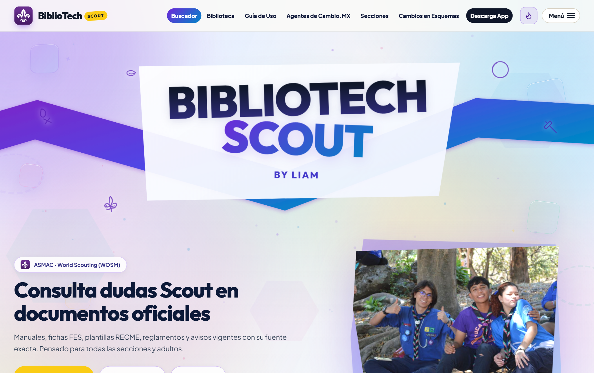 | 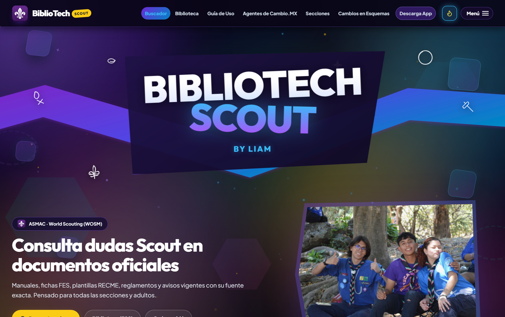 |

### Teléfono Móvil (`390×844`)

| Móvil Web — Modo Claro | Móvil Web — Modo Oscuro |
| :---: | :---: |
| 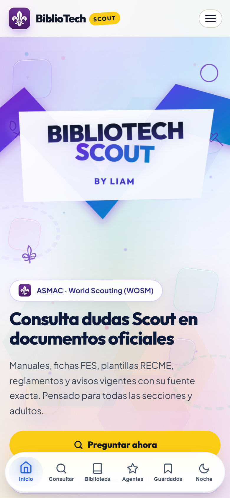 | 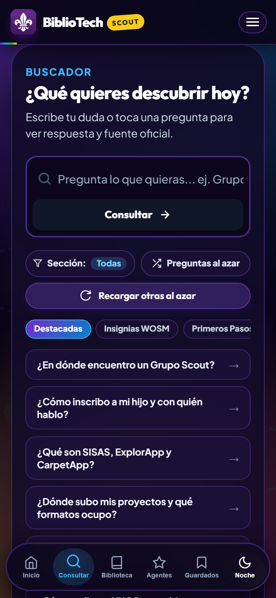 |

---

## 4. Vistas por Dispositivo y Plataforma

### Tablet (Navegador y App Android APK) vs iPhone / iPad (iOS Safari Web App)

| Tablet Web (`820×1080`) | iPhone / iPad (`iOS Safari` Web App) |
| :---: | :---: |
| 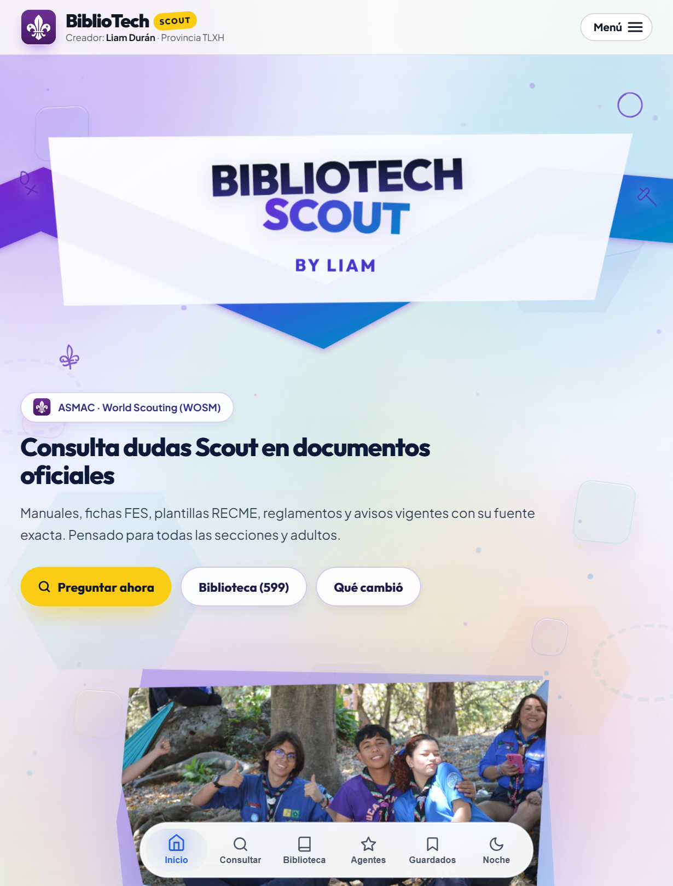 | 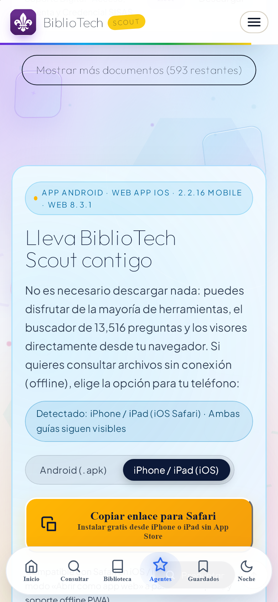 |

### Teléfono y Tablet con App Android (APK `v2.3.3`)

| Teléfono Android (`APK`) | Tablet Android (`APK`) |
| :---: | :---: |
|  | 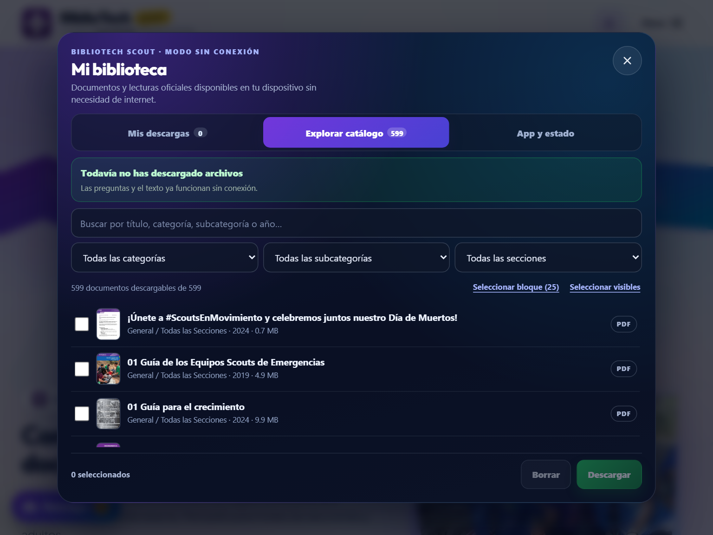 |

---

## 5. Apartados del Sitio y Qué Puedes Hacer en Cada Uno

| Apartado | Función y qué puedes hacer ahí | Vista |
| :--- | :--- | :---: |
| **Buscador (`#buscador`)** | Escribe cualquier duda scout, filtra por sección (*Manada*, *Tropa*, *Comunidad*, *Clan*, etc.), abre el filtro rápido de **Sección**, genera o recarga **Preguntas al azar**, lee respuestas fundamentadas con fuente documental exacta, nomenclatura oficial y documentos relacionados, y escúchalas con lectura en voz alta. | 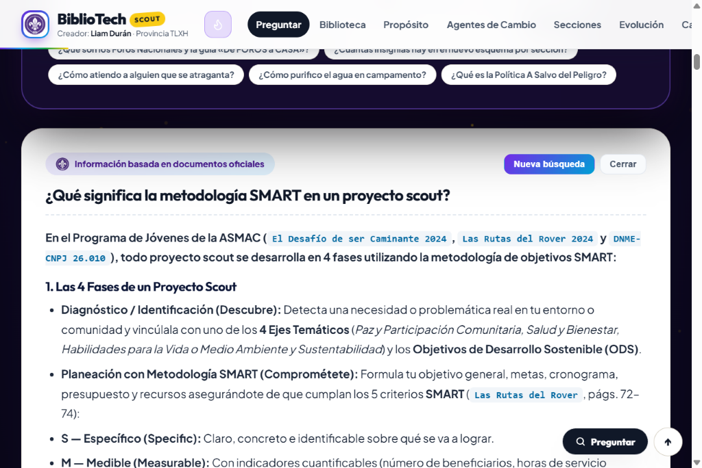 |
| **Biblioteca Scout (`#biblioteca`)** | Filtra por texto, sección, colección (*Centenario*, *Guías y PJOS*, *FES*, *RECME y FAES*, *SISAS y Help Desk*, *Manuales*, *Reglamentos*, *Comunicados*, etc.) o subcategoría entre los `883` documentos oficiales (con carga progresiva de `12` en `12`); guarda favoritos, toma notas locales, consulta preguntas relacionadas con cada documento y abre PDFs pesados (`50–300+ MB`) con streaming por página, hojas Excel con filtro/CSV, presentaciones, guías HTML o imágenes sin salir del sitio. | 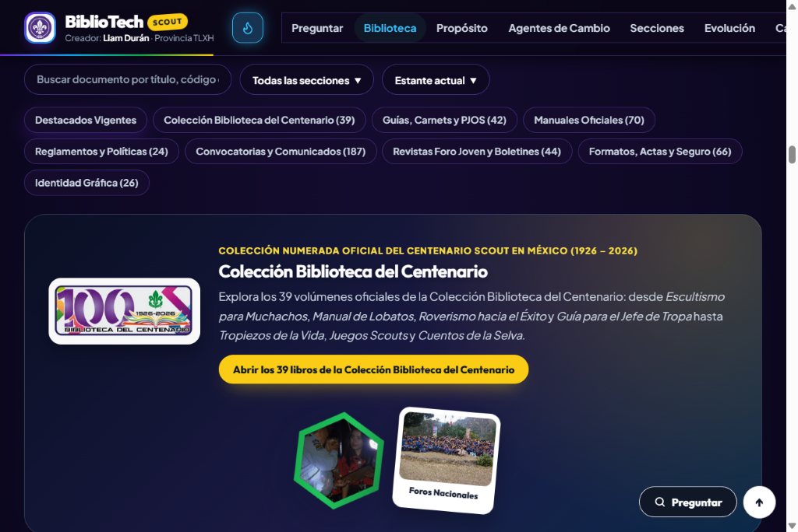 |
| **Guía de Uso (`#guia`)** | Tarjetas plegables numeradas (*01 Primeros Pasos*, *02 Ecosistema Digital*, *03 Campo Escuela Meztitla*, etc.) desplegadas por defecto con respuestas rápidas, cuotas de registro, permisos JL304 y enlaces oficiales al tocar cada tema. | 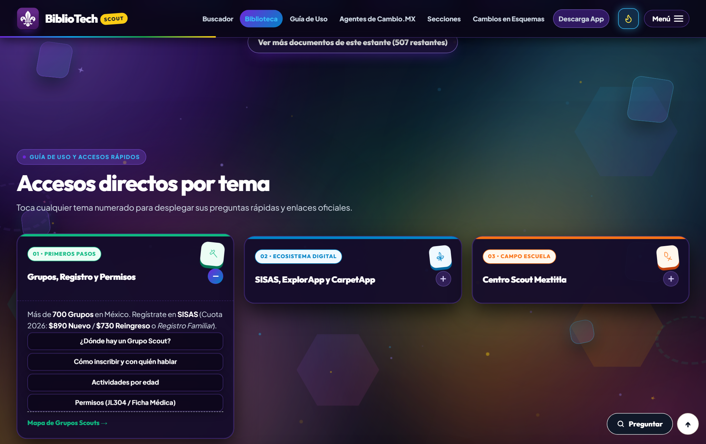 |
| **Secciones Scouts (`#secciones`)** | Acceso directo unificado por rango de edad (*Manada de Lobatos*, *Tropa de Scouts*, *Comunidad de Caminantes*, *Clan de Rovers*, *Adultos y Dirigentes* y *World Scouting WOSM*) para filtrar al instante sus documentos, progresiones e insignias. | 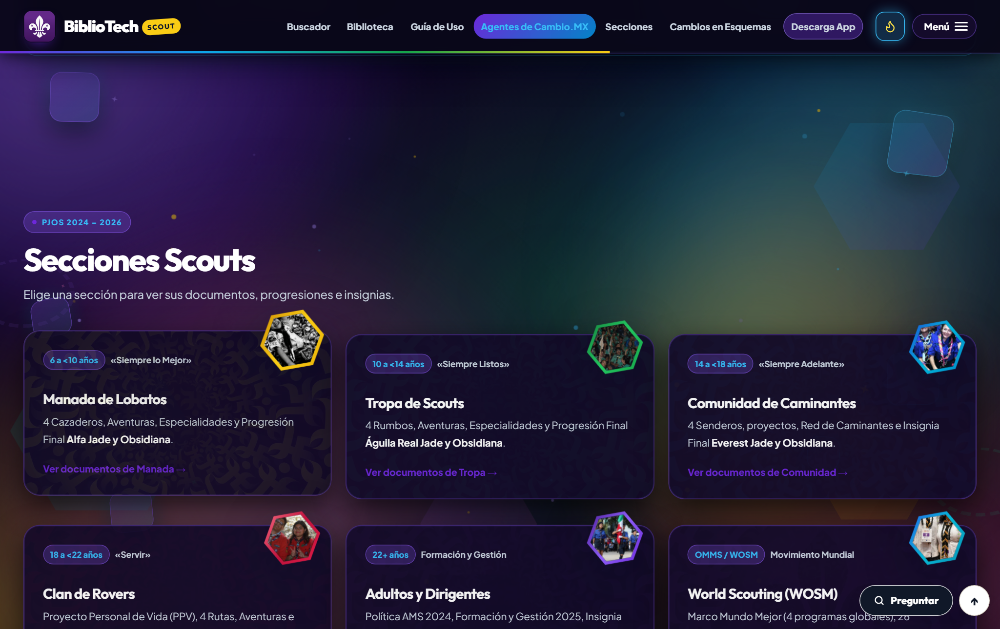 |
| **¿Qué es BiblioTech? (`#acerca`)** | Presentación transparente del proyecto sin fines de lucro, su objetivo educativo, resumen de capacidades, datos de autoría y correo/reporte para mejoras o fallas. | 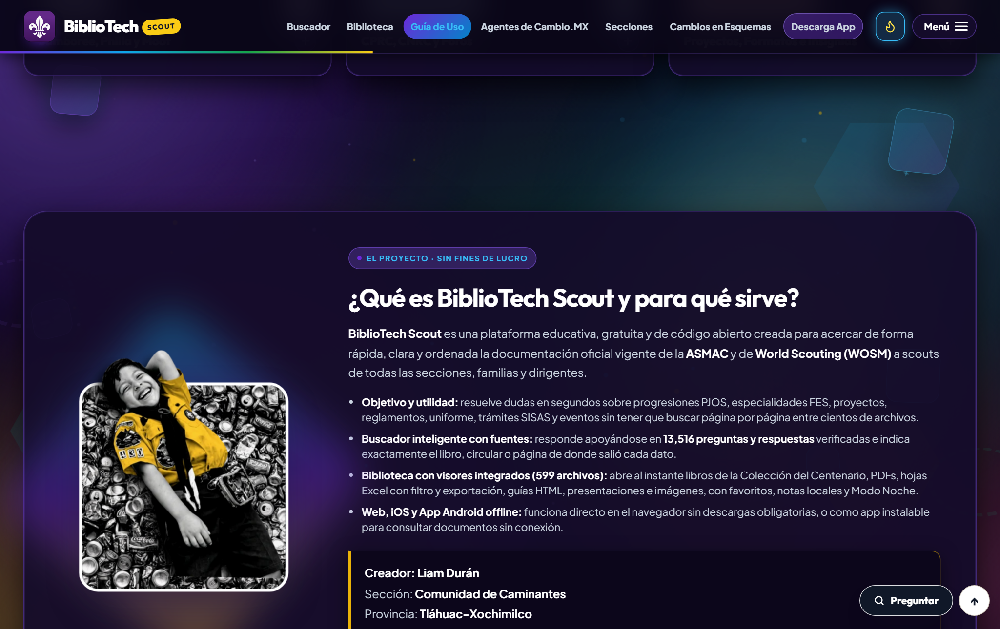 |

*(Desde la barra superior accedes directamente a los espacios dedicados: **Inicio**, **Guía**, **Biblioteca**, **Ejes Temáticos**, **Skills**, **Agentes de Cambio**, **La Fogata**, **Editor de archivos**, **Acerca de** y **Descarga**).*

---

## 6. Comparativa de Funciones: Web / iOS Web App vs App Android (APK)

| Capacidad | Sitio Web (Escritorio / Móvil) | iOS Safari Web App (iPhone / iPad) | App Android (APK Oficial) |
| :--- | :---: | :---: | :---: |
| Buscador con `21,293` preguntas, nomenclaturas y fuentes cruzadas | En línea / Offline opcional | Descarga offline iOS Safari/PWA | 100% Offline nativo |
| Biblioteca de `883` documentos oficiales con visores integrados | En línea (streaming HTTP 206) | En línea (streaming HTTP 206) | En línea + Descarga offline |
| Favoritos (`Guardados`), historial reciente y notas locales | Cookies + `localStorage` | Cookies + `localStorage` | Guardados + Almacenamiento nativo |
| Modo Claro y Modo Oscuro unificados | Incluido | Incluido | Incluido |
| Lector PDF para archivos pesados (`50–300+ MB`) sin límite de 25 MB | Streaming por página (`PDF.js` + Nativo) | Streaming por página (`PDF.js`) | Nativo (`PdfRenderer`) + Streaming |
| Gestor de descargas por lote (25 o individuales) | Descarga individual | Descarga Safari | Nativo (`Mi biblioteca`) |
| Actualizaciones en segundo plano (interfaz y `data/`) | Automática al recargar | Automática (`sw.js`) | Descarga atómica OTA integrada |

---

## 7. Herramientas y Tecnologías Utilizadas

El proyecto está construido evitando dependencias pesadas en el cliente y apoyado en herramientas verificables en el repositorio:

- **Frontend e Interfaz Web:** `HTML5` semántico, `CSS3` (variables personalizadas, modo ligero adaptativo `data-bt-perf="lite"` para dispositivos de baja gama, diseño responsivo desktop/tablet/móvil y modos Claro/Oscuro), `JavaScript (ES6+)`.
- **Web App y Accesibilidad:** PWA (`manifest.webmanifest`, `sw.js` con estrategia *Network-First*), ícono compatible con iOS (`img/apple-touch-icon.png`), `PDF.js` bajo demanda con streaming HTTP Range (`256 KB` por bloque) y `Web Speech API` para lectura en voz alta.
- **Procesamiento, Build y Calidad (`scripts/` y CI):** `Node.js` (`esbuild` para minificación CSS/JS desde `src/` y validaciones en GitHub Actions `ci.yml`); `Python 3` con `pypdfium2` (extracción de texto PDF), `Pillow` (generación y optimización de portadas JPG e íconos), `openpyxl` (procesamiento de hojas Excel) y `Playwright` (pruebas E2E en escritorio, móvil e iOS).
- **Infraestructura y Distribución:** `GitHub Pages` para publicación automática del sitio web, `GitHub Actions` para CI automatizado y `Cloudflare Workers` (`cloudflare-worker/worker.js` `v2.1` con KV `FORUM_KV` y streaming HTTP 206 para PDFs oficiales de GitHub Releases).

---

## 8. Novedades Recientes (`9.8.0`)
- **Visor PDF interactivo por página para archivos pesados (`50 MB` a `300+ MB`):** soluciona de raíz el límite de `25 MB` de Google Docs Viewer mediante streaming HTTP 206 por bloques de `256 KB` a través de Cloudflare Worker `v2.1` (`/pdf/<sha12>.pdf`) y renderizado en alta definición con `PDF.js`, controles de página (`Anterior`, `Pág. X / N`, `Siguiente`), zoom, `Visor Nativo` y tarjeta de resiliencia con portada y lectura inmediata de texto.
- **Rediseño visual editorial y motor de rendimiento para dispositivos de baja gama (`9.7.0`–`9.8.0`):** eliminación de bucles CSS infinitos y `backdrop-filter` en elementos con scroll, detección automática `data-bt-perf="lite"`, botones y tarjetas unificados en los 7 espacios y contraste reforzado en modo oscuro.
- **Banco ampliado a `21,134` preguntas verificadas (+42.5%) y enlaces cruzados (`related_doc_ids`):** cobertura del 100% de los `883` documentos oficiales (`664` con nomenclatura oficial visible), barra de **Preguntas relacionadas con este documento** con recarga aleatoria dentro del lector y hasta 5 documentos relacionados por respuesta.
- **Depuración integral del repositorio:** eliminación de más de `133 MB` de activos y grabaciones locales no referenciados, reglas CSS obsoletas y scripts históricos de un solo uso, manteniendo el 100% de los activos en su calidad original.
- **Editor de Archivos activo (100% local y offline):** 6 plantillas oficiales editables (*Ficha Médica y de Salud* de 2 hojas completa, *Permiso de Salida JL304*, *Ficha de Especialidad FES*, *Cédula de Proyecto SMART*, *Convocatoria y Programa*, *Acta de Consejo/Corte de Honor*) con selector oficial de las 42 Provincias Scout de México y autollenado local.

### Versión anterior (`9.2.0`)
- **Optimización móvil (Web/iOS y Android):** arranque en paralelo de `catalog.json` + `knowledge_base.json`, renderizado diferido de Biblioteca y cadenas de versión, eliminación de layout thrashing en scroll, timeouts con `AbortController` en `version.json` y La Fogata, y menor carga GPU en celulares.
- **Cero botones encimados en móvil:** botón `↑` posicionado encima del dock inferior, toasts elevados con margen de seguridad, `padding-bottom` ampliado para el dock y ocultamiento automático de flotantes con modales abiertos.
- **Limpieza de botones duplicados:** eliminados accesos repetidos en el Hero de Inicio, menú hamburguesa, Biblioteca móvil (`Guardados` ya vive en el dock), tarjetas del espacio Formatos y en la versión Android nativa.
- **Memoria de diseño y reglas del repositorio:** añadidos `DESIGN.md` y `AGENTS.md` adaptados al stack Vanilla offline de BiblioTech Scout.

### Versión anterior (`9.1.0`)

- **Arquitectura en 5 Espacios Dedicados (`Inicio`, `Biblioteca y Catálogo`, `Guía Scout`, `La Fogata`, `Formatos`):** separa la navegación en vistas limpias con URLs compartibles (`?vista=...`), manteniendo las cookies locales, favoritos y modo offline unificados.
- **Lector de Documentos Compacto y Ergonómico (`#docModal`):** cabecera de 1 fila con cajón `Info` plegable para ganar espacio de lectura, selector `Documento / Texto rápido` integrado y barra inferior fija al pulgar en móvil/iOS.
- **Biblioteca y Catálogo unificados:** conmutador superior entre *Estantes Visuales (599)* y *Catálogo Avanzado* (filtros expertos por formato, subcategoría y ediciones recientes) más acceso directo a *Mis Guardados y Notas*.
- **Sub-navegación en Guía Scout:** barra superior para ver todo o enfocarse en *Guía de Uso*, *Secciones*, *Agentes de Cambio.MX*, *Servicios y Trámites*, *Cambios en Esquemas*, *¿Qué es BiblioTech?* o *App y Offline*.
- **Dock móvil equilibrado (5 botones):** *Inicio*, *Biblioteca*, *Fogata*, *Formatos* y *Guardados*.

---

## 9. Estructura Principal del Repositorio

```text
bibliotech-scouts/
├── index.html                  # Estructura semántica principal (12 apartados ordenados)
├── src/                        # Fuente editable: styles.css y app.js
├── styles.css / app.js         # Salida depurada y minificada generada con npm run build
├── sw.js                       # Service Worker PWA (bibliotech-scout-v64)
├── manifest.webmanifest        # Manifiesto Web App / PWA (iconos maskable y shortcuts)
├── data/                       # catalog.json (883 docs), questions_bank.json, faq_v3.json, faq_v4.json (21,293 preg), kb, chunks
├── covers/                     # Carátulas optimizadas en JPG (883 documentos oficiales)
├── img/                        # Logotipos, fondos temáticos, galería, formatos y apple-touch-icon.png
├── assets/                     # Recursos gráficos esenciales de interfaz
├── cloudflare-worker/          # worker.js v2.1 (La Fogata KV, telemetría y streaming HTTP 206 de PDFs pesados)
├── scripts/                    # build-assets.mjs, validate-site.mjs, smoke_e2e.py y utilidades de ingesta/auditoría
├── .github/workflows/ci.yml    # CI automatizado (validación + E2E Playwright)
├── ARCHITECTURE.md             # Documentación técnica y traspaso interno
└── docs/screenshots/           # Capturas verificadas de escritorio, tablet, móvil, iOS y Android
```
